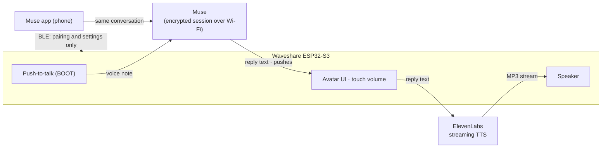

# Waveshare × Muse Gadgets

**Meta's [Muse Gadget SDK](https://github.com/facebookincubator/muse-gadget-sdk), running on three round and square Waveshare ESP32-S3 boards — and talking back out loud.**

  
   
  Muse on all three: the <b>LCD 1.85C</b> in its speaker enclosure (back), the round <b>AMOLED 1.43C</b> (front) and the <b>AMOLED 1.8</b> waiting for Wi-Fi (right).

This is a fork of `facebookincubator/muse-gadget-sdk` that adds three Waveshare boards to the ESP32 Device SDK, plus a few features the upstream firmware doesn't have yet: spoken replies, replies you didn't ask for (pushes), touch volume and battery level on boards without a power chip.

| | Waveshare ESP32-S3-Touch-LCD-1.85C | Waveshare ESP32-S3-Touch-AMOLED-1.43C | Waveshare ESP32-S3-Touch-AMOLED-1.8 |
|---|---|---|---|
| Screen | 1.85" round LCD, 360×360, ST77916 (QSPI) | 1.43" round AMOLED, 466×466, SH8601 (QSPI) | 1.8" AMOLED, 368×448, SH8601 or CO5300 (QSPI) |
| Touch | CST816 | FocalTech-style @ 0x15 | FT3168 or CST816 |
| Audio | ES8311 + amp, ES7210 dual mic | ES8311 + NS4150B, ES7210 dual mic | ES8311 (speaker and mic) |
| Power | No PMU · battery by ADC | No PMU · battery by ADC + charge pin | AXP2101 |
| Flash / PSRAM | 16 MB / 8 MB octal | 8 MB / 8 MB octal (PICO-1-N8R8) | 16 MB / 8 MB octal |
| Talk button | BOOT | BOOT | BOOT (PWR is aux) |
| Alias | `s185c` | `s143c` | `s18` |

| | |
|---|---|
| [**ESP32 Device SDK**](esp32) | Connect your ESP32 board to Muse through our open source SDK. Throw in a screen to show images, add audio in and out, or wire up other sensors. |
| [**Linux Device SDK**](linux) | Turn that spare Raspberry Pi or Linux box into a Muse gadget. Hack in your own commands to let Muse handle sysadmin chores or your Home Assistant setup. |
| [**Muse Gadgets Test**](android/musegadgetstest) ([iPhone](ios/musegadgetstest)) | Stream your phone's camera, or a clip, to an ESP32 gadget's screen over Wi-Fi: H.264 or VP8 decoded on the board, 30 fps on the round 466 px boards. [`protocols/VIDEO.md`](protocols/VIDEO.md) explains how. |

## What's new compared to upstream

ESP32 and Linux gadgets pair with the Muse app on iOS and Android, via
Settings > Devices. Turn on Developer mode there first, then look for devices
prefixed with "MuseGadget".
Each directory has a `README.md` to get started and an `AGENTS.md` for coding
agents like [Muse Code](https://developer.meta.com/ai/lp/muse-code/).
[`protocols/DEVICE.md`](protocols/DEVICE.md) says how a gadget describes itself
to Muse.

For battery-input power profiling, see the [porting recipe](esp32/docs/power/README.md).
The opt-in diagnostic core is board-neutral; boards supply its hooks and state
matrices, and [power_sweep.py](esp32/tools/power/power_sweep.py) drives the
USB-free sweep. The isolated diagnostic does not pair or need an SDK token;
fixture safety and explicit hardware authorization still come first, as the
[PPK2 rules](esp32/docs/power/ppk2.md) describe.

| Feature | What it does | Where |
|---|---|---|
| [`esp32/components/minimp3/include/minimp3.h`](esp32/components/minimp3) | [lieff/minimp3](https://github.com/lieff/minimp3) | CC0-1.0, see [`LICENSE`](esp32/components/minimp3/LICENSE) |
| [`esp32/components/muse/boards/ostb_echoear_display_init.h`](esp32/components/muse/boards/ostb_echoear_display_init.h) | [78/xiaozhi-esp32 ESP-VoCat panel sequence](https://github.com/78/xiaozhi-esp32/blob/0d576d3d4c049c6f55eaf879725dc23e516511b4/main/boards/espressif/esp-vocat/esp_vocat.cc) | MIT, retained in the file header |
| ST7789 tuning table in [`board_atk_dnesp32s3_box2.c`](esp32/components/muse/boards/board_atk_dnesp32s3_box2.c) | [78/xiaozhi-esp32 ATK-DNESP32S3-BOX2 board](https://github.com/78/xiaozhi-esp32/blob/a78ca19d5bc9a12ee0853b9f509530276d36aa03/main/boards/alientek/atk-dnesp32s3-box2-wifi/atk_dnesp32s3_box2.cc) | MIT, see [`xiaozhi-esp32.txt`](esp32/devices/licenses/xiaozhi-esp32.txt) |
| JD9853A initialization sequence in [`board_seeed_xiao_s3_147.c`](esp32/components/muse/boards/board_seeed_xiao_s3_147.c) | [Seeed-Studio/Seeed_GFX2](https://github.com/Seeed-Studio/Seeed_GFX2) | MIT, see [`Seeed_GFX2.txt`](esp32/devices/licenses/Seeed_GFX2.txt) |
| [`esp32/components/muse/boards/viewe_smartring_display_init.h`](esp32/components/muse/boards/viewe_smartring_display_init.h) | [VIEWESMART/smartring_plus](https://github.com/VIEWESMART/smartring_plus) panel sequence | Apache-2.0 under VIEWE's copyright, in the file header |
| [`esp32/components/muse/boards/waveshare_s3_185b_init.h`](esp32/components/muse/boards/waveshare_s3_185b_init.h) | [waveshareteam/ESP32-S3-Touch-LCD-1.85B](https://github.com/waveshareteam/ESP32-S3-Touch-LCD-1.85B/tree/7232af4c501c64d34215b73e1d8319376dfd9c19/examples/esp-idf/05_bq27220/components/esp32_s3_touch_lcd_1_85B) panel sequences | Apache-2.0, in the file header |
| [`esp32/main/pixel_font.c`](esp32/main/pixel_font.c) | Adafruit GFX `glcdfont.c` | BSD-2-Clause, in the file header |
| [`esp32/components/muse/fonts/`](esp32/components/muse/fonts) | GNU Unifont 16.0.04, Noto Sans SC, and Montserrat Medium via LVGL, subsets (see its README) | SIL Open Font License 1.1 (Unifont also GPL-2.0+ with the font embedding exception) |
| [`esp32/components/muse/eink/fonts/montserrat.ttf`](esp32/components/muse/eink/fonts) | Montserrat Medium, via LVGL v9.5.0 | SIL Open Font License 1.1 |
| [`esp32/components/muse/eink/fonts/unscii.ttf`](esp32/components/muse/eink/fonts) | unscii-8 | Public domain |
| [`esp32/components/muse/eink/fonts/symbols.ttf`](esp32/components/muse/eink/fonts) | Font Awesome 5 Free, via LVGL v9.5.0 | SIL Open Font License 1.1 (icons CC BY 4.0) |
| [`esp32/main/epd_ssd1677.c`](esp32/main/epd_ssd1677.c) | Seeed-reTerminal-E10xx-Firmware's SSD1677 refresh sequence | MIT, retained in the file header |
| [`esp32/components/tinyh264/src`](esp32/components/tinyh264) | the Android Open Source Project's H.264 decoder, via [udevbe/tinyh264](https://github.com/udevbe/tinyh264) | Apache-2.0, AOSP's copyright, see [`LICENSE`](esp32/components/tinyh264/LICENSE) |
| [`esp32/components/libvpx_vp8/src`](esp32/components/libvpx_vp8) | [libvpx](https://chromium.googlesource.com/webm/libvpx) v1.16.0's VP8 decoder, trimmed | BSD-3-Clause, the WebM Project authors' copyright, see [`LICENSE`](esp32/components/libvpx_vp8/LICENSE), with Google's patent grant in [`PATENTS`](esp32/components/libvpx_vp8/PATENTS) |

The Apache License does not cover the [Jollybot avatar](esp32/avatar).

Muse Gadgets Test's sample clips aren't in this repository: the app fetches a few
seconds of the Blender Foundation's open movies (CC BY 3.0) when one is
played, and shows their credits.

Muse Gadgets Test can use x264 (GPL-2.0) on the phone; this repository carries none
of its code. An APK or iPhone app you build with it is under the GPL
([`android/musegadgetstest/README.md`](android/musegadgetstest/README.md),
[`ios/musegadgetstest/README.md`](ios/musegadgetstest/README.md)).
